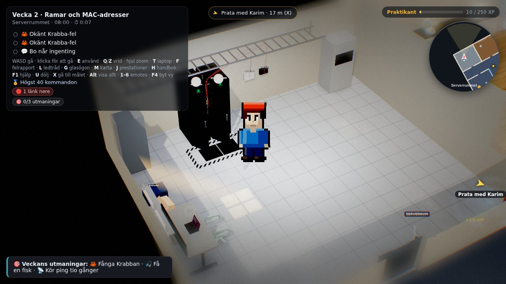
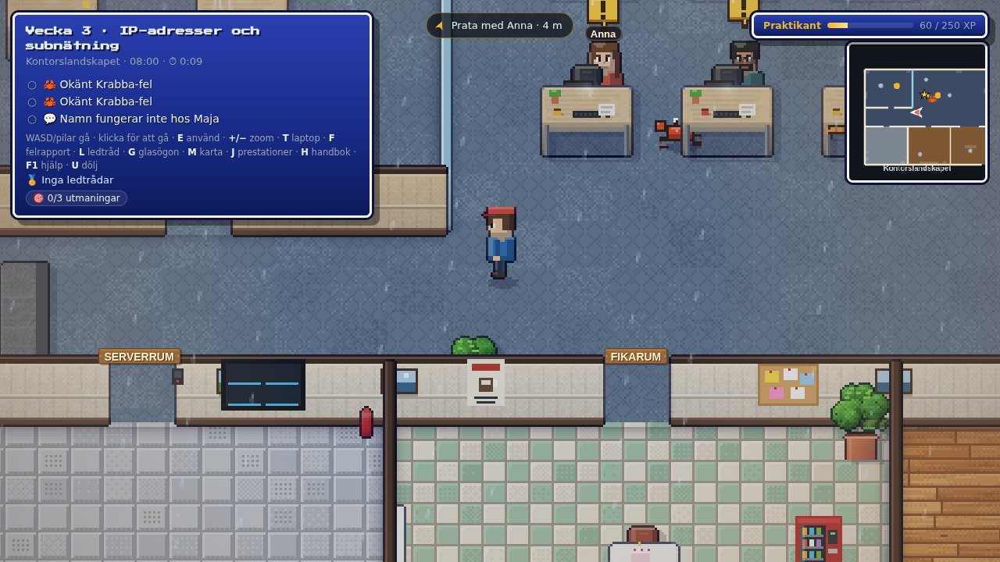
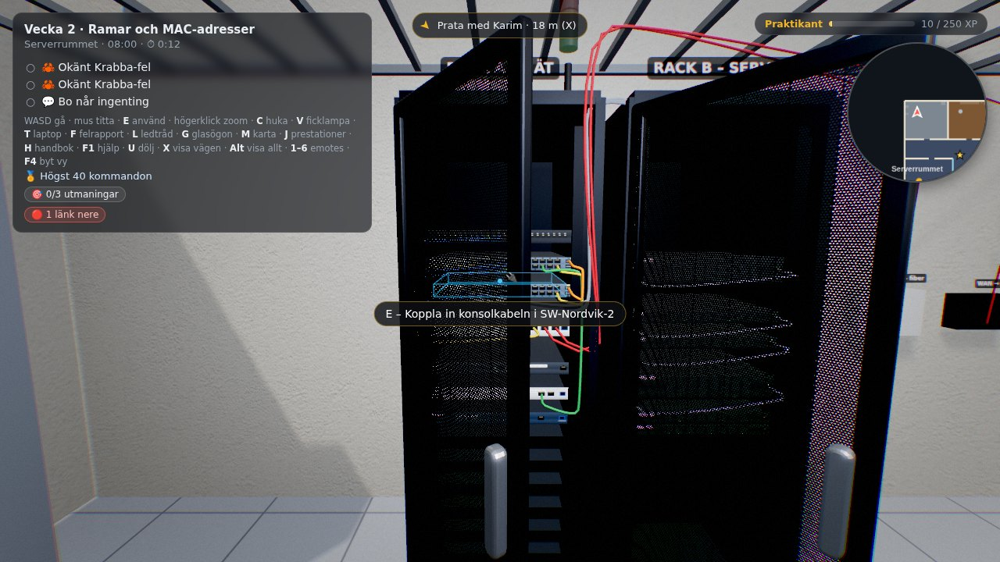
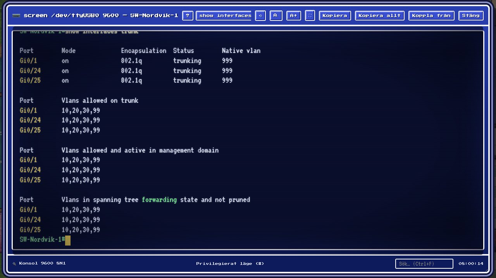

<p align="center">
  
</p>

<h1 align="center">Krabba-passet 🦀</h1>

<p align="center">
  <strong>Bli nätverkstekniker på Nordvik – och laga det Krabban har förstört.</strong><br>
  Ett nätverksspel för kurserna <em>Nätverksteknik</em> och <em>Routing och switching</em>.
</p>

<p align="center">
  <a href="https://github.com/felixarvid2/Krabba-passet/releases/latest"></a>
  
  
</p>

Du är ny nätverkstekniker på Nordvik och går runt på huvudkontoret i Göteborg och på lagret i Borås. Varje vecka har "Krabban" gjort sönder två saker i racket, och en kollega har ett ärende till dig. Du kopplar in konsolkabeln i Cisco-utrustningen, felsöker med riktiga CLI-kommandon, rättar felet och skriver en felrapport.

Nätet, adressplanen och felen följer kursboken *Nätverksteknik – Från sladden och uppåt*. Kurs 2, *Routing och switching*, fortsätter med Mölndalskontoret, OSPF och BGP.

## Spela

1. Ladda ner senaste zip-filen under [Releases](https://github.com/felixarvid2/Krabba-passet/releases/latest).
2. Packa upp den.
3. Dubbelklicka på `index.html`.

Spelet öppnas i Chrome, Edge eller Firefox och behöver ingen webbserver, installation eller internetuppkoppling. Framstegen sparas i webbläsaren.

Vill du köra den allra senaste versionen från källkoden:

```bash
node tools/offline.js   # en gång, skapar assets3d/offline.js
```

Öppna sedan `index.html` direkt från mappen. Alternativt startar du en lokal webbserver med `npx http-server .` och går till `http://localhost:8080`.

## Fyra sätt att se spelet

Välj visning i startmenyn. Valet sparas och kan bytas mitt i en vecka.

| 2D | HD-2D |
|---|---|
|  |  |
| **3D** | **Terminalen** |
|  |  |

- **2D** – en 16-bitars pixelvärld sedd snett uppifrån. Gå med WASD eller klicka där du vill gå.
- **HD-2D** – spelets pixelfigurer i ett 3D-kontor, som ett diorama med ljus, skuggor och tilt-shift.
- **3D** – förstaperson i ett stiliserat kontor med glöd, reflektioner och partiklar.
- **Terminalen** – där jobbet faktiskt görs. Riktiga Cisco-kommandon, `show`-utdata och felsökning.

3D-läget kräver WebGL. Saknas det startar spelet i 2D.

## Det här gör du

- **Läs ärenden** i ärendelistan (`Tab`) och ta reda på vad kollegorna behöver hjälp med.
- **Koppla in konsolen** i racket och felsök med `show`, `ping`, `traceroute` och andra kommandon.
- **Rätta felet** och bevisa att det fungerar – särskilt i svårt läge.
- **Skriv felrapport** (`F`) och lämna in.
- **Bygg från grunden** – fabriksinställda enheter som du konfigurerar steg för steg.
- **Följ karriären** (`J`) med XP, rang, prestationer och veckoutmaningar.
- **Använd handboken** (`H`) med kommandon, felbibliotek, adressplan, subnätsräknare och ordlista.
- **Fånga Krabban** när den gömmer sig nära ett av veckans fel – den ger en ledtråd.
- **Ta en kaffe** för att gå snabbare, och lyssna på kontoret, regnet och fläktarna.

## Kursinnehåll

| Del | Innehåll |
|---|---|
| **Kurs 1, vecka 1–10** | Konsolen, ramar och MAC-adresser, IP och subnätning, VLAN och trunkar, routing, NAT och SSH, drift och övervakning, trådlöst, säkerhet och brandvägg, VPN och lastbalansering. |
| **Bygg från grunden 1–5** | Fabriksinställda enheter som du konfigurerar steg för steg. |
| **Kurs 2, vecka 11–14** | Nav och ekrar, brandvägg och VPN, OSPF, BGP med PAT och reservdefault. Finns i källkoden och i version 11 och framåt. |

Varje fel är simulerat: symptomen räknas fram ur konfigurationen, och felet försvinner bara när orsaken är rättad.

### Svårighetsgrad

Under **Inställningar** väljer du Lätt, Normal eller Svår. I svårt läge säger spelet inte till när ett fel är löst – du måste bevisa det, till exempel genom att pinga från rätt dator eller visa rätt `show`-utdata. Ärendelistan visar vad som räknas som bevis. Ingen kompasspil och 1,5 gånger XP.

## Styrning

| Tangent | Gör |
|---|---|
| `W` `A` `S` `D` / piltangenter | Gå |
| `Shift` | Spring |
| Klick | Gå dit / använd det du klickar på |
| `E` / `Mellanslag` / `Enter` | Använd: koppla in konsolen, prata, använda dator |
| Mushjul / `Z` / `X` | Zooma |
| `T` | Öppna laptopen |
| `F` | Skriv felrapport |
| `L` | Ledtråd |
| `H` | Handbok |
| `Tab` | Ärendelistan |
| `M` | Karta |
| `K` | Minikarta |
| `J` | Karriär och prestationer |
| `N` | Anteckningar |
| `F1` | Hjälp |
| `Esc` | Paus / stäng |

I terminalen fungerar `?`, `Tab`, piltangenter, `Ctrl+C`, `Ctrl+Z`, `Ctrl+L`, `Ctrl+U`, `Ctrl+W` och `PageUp`/`PageDown`. Konsolen kopplas med `sudo screen /dev/ttyUSB0 9600`. SSH-kontot står på lappen: `drift` / `nordvik`.

### På mobil och surfplatta

Styr med spak och knappar, dra med fingret för att titta i 3D och tryck direkt på saker. Menyn ☰ uppe till höger har alla funktioner. Mobiler startar i 2D, men 3D finns i menyn. Liggande läge rekommenderas.

## För utvecklare

<details>
<summary>Kör, testa och bygg</summary>

```bash
npx http-server -p 8765 -c-1 .   # lokal server för webbläsartesterna
node test/levels.js              # veckornas fel och lösningar
node test/build.js               # bygg från grunden
node test/kurs2.js               # kurs 2
node test/smoke.js               # DHCP, ping, NAT, DNS och STP
```

Webbläsartesterna använder Playwright och ligger i `test/`. Kodstrukturen och arbetsflödet finns i [CLAUDE.md](CLAUDE.md), och alla versionsanteckningar finns i [docs/CHANGELOG.md](docs/CHANGELOG.md).

</details>

## Versioner

Se [Releases](https://github.com/felixarvid2/Krabba-passet/releases) för färdiga versioner och [docs/CHANGELOG.md](docs/CHANGELOG.md) för vad som har ändrats.

## Licenser

Spelet använder three.js (MIT), typsnitten VT323 och Press Start 2P (SIL Open Font License) samt modeller och texturer från Kenney, Quaternius och ambientCG (CC0). Licenserna finns i `lib/` och `assets3d/LICENSES/`.
